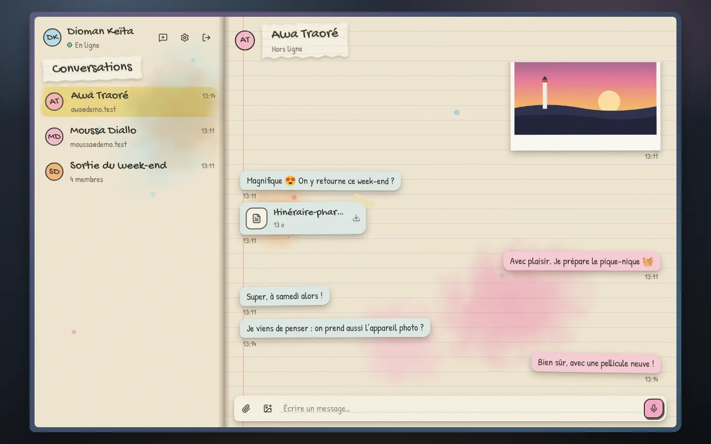
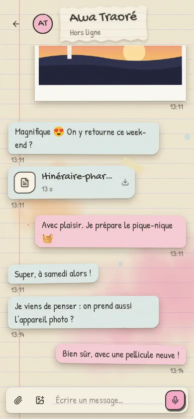

# Converse design

Art direction and design system of the web client, for people **and AI agents** changing the interface.

| File | Contents |
| --- | --- |
| [art-direction.md](art-direction.md) | The intent: the correspondence notebook, the inspiration and its limits, the pillars, do / don't |
| [design-system.md](design-system.md) | The practice: tokens, fonts, materials, components, layout, motion, checklist |

Reference captures: [`screenshots/`](screenshots/).

When the interface changes, **update these files in the same PR** (new component, color, animation or wording style).

| Desktop | Mobile |
| --- | --- |
|  |  |
